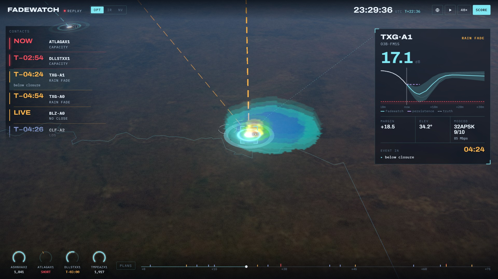
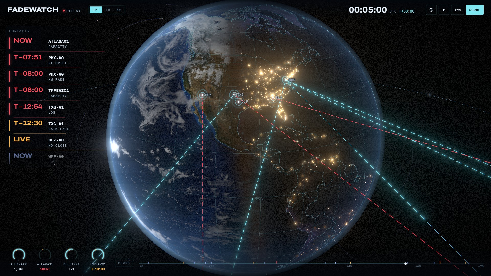

# Fadewatch

**Fadewatch sees satellite links fail before they do.** It forecasts every link's SNR from orbital
geometry, a calibrated link budget and a rain nowcast. It warns minutes to half an hour before a
satellite sets, a storm fades a Ka-band path, a receive chain degrades or a demand pool runs out of
capacity, and it plans what to do about each. It runs on [Constellation](https://constellation.space)'s
API, MCP server and [demo fleet](https://huggingface.co/datasets/constellationspace/demo-fleet).



▶ **[Demo video (1:48, with sound)](docs/fadewatch-demo.mp4)**. Or run it yourself in under a minute:
`pip install -e . && fadewatch serve`, then open `http://127.0.0.1:8765/?tour` for the guided replay, or
without `?tour` to fly it yourself.



## Why this exists

Constellation's served SNR model, `snr-baseline-v1`, is
[a persistence baseline](https://platform.constellation.space/docs/models/snr): its median at every
horizon is the last observed SNR, and its model card lists "predicting a fade or recovery the link has
not shown yet" as out of scope. That makes it a good reference, and blind to the failures that matter
most. Most link drops are predictable from physics, though:

| Why links fail | What you can know in advance |
|---|---|
| The satellite sets below the elevation mask | Exactly when, from its orbital elements |
| Rain crosses the slant path (Ka band) | Roughly when and how badly, from a radar nowcast and the path geometry |
| A receive chain degrades | That the SNR is drifting away from what geometry and weather explain |
| A pool loses capacity | Which links will carry it, at what MODCOD, against what demand |

Fadewatch is the model and the agent built on those four facts.

## Results

Fadewatch was scored against a replica of `snr-baseline-v1` on a 75-minute replay of the demo fleet,
continued forward from its snapshot. The replay adds a Ka-band thunderstorm crossing Texas Gateway, a
failing LNA at Phoenix Gateway and an interferer at O3B1.WMP (`fadewatch backtest`; full tables in the
dashboard's Backtest tab).

| Events in the replay | Fadewatch warned ≥ 1 min ahead | Median lead | Persistence warned |
|---|---|---|---|
| Satellites setting below the mask (loss of signal) | **12 of 12** | 15.1 min | 0 of 12 |
| Fades below closure (rain, equipment) | **2 of 2** | 30.8 min | 0 of 2 (30 s and 48 s) |
| Demand pool short of capacity | **5 of 5** | 9.8 min | 0 of 5 |

* **No false warnings.** All 23 warnings were confirmed by what happened next (one more predicted a
  loss of signal past the end of the replay). A clear-sky replay of the same fleet raised none.
* **Forecast error at Constellation's own horizons** (MAE, Fadewatch vs persistence):
  0.22 vs 0.44 dB at 1 min, 0.61 vs 1.84 dB at 5 min. In rain, 1.58 vs 5.39 dB at 5 min; under the
  failing LNA, 0.72 vs 4.38 dB. The 80% interval holds the truth 84% of the time at 5 min,
  against 57% for persistence.
* **Closed loop.** Replayed with Fadewatch's plans executed (make-before-break handovers on spare
  antennas, and a spare at Texas Gateway brought up on the satellite whose path the nowcast kept
  clearest), pool DLLSTXX1's unserved traffic fell from 22.3 to 7.0 Gbit (−69%), and handover gaps
  fell from 26.3 to 20.0 antenna-minutes.
* **Where it doesn't help.** Interference has no precursor. Fadewatch flags the step within a minute
  and stops extrapolating it, but its 5-minute error during the burst (8.4 dB) is no better than
  persistence's (7.8 dB). Phoenix Gateway has a single antenna, so its handover gap and its failing LNA
  cannot be planned away, only warned about early.

### On a real Constellation account

`fadewatch live` ran against a free-tier account on 2026-10-13 (sanitised report:
[data/live-results.json](data/live-results.json)). It loaded the demo fleet through Constellation's MCP
server, pulled 4,610 samples of recorded telemetry over 14 live links from `/topology/series`, and scored
both models on them:

| MAE on Constellation's recorded telemetry | 1 min | 3 min | 5 min |
|---|---|---|---|
| **Fadewatch** | **0.007 dB** | **0.009 dB** | **0.010 dB** |
| Persistence (`snr-baseline-v1` replica) | 0.095 dB | 0.250 dB | 0.356 dB |

* **The replica is the real model.** One `/predictions` call (36 forecasts, release
  `snr-baseline-v1-20260914T081352Z`) matched the replica's median exactly on every item. The served
  80% band barely widens with horizon (±0.33 dB at 1 min, ±0.36 dB at 5 min), so the replica now uses
  those measured widths, and every number in this README is against them.
* **It wrote back.** All 69 records were accepted: per-link forecasts and rain as `telemetry` and
  `attenuation`, plus current TLEs for all 39 satellites through the satellite contract.
* **The replay offset moves.** The demo fleet is re-stamped on every load: today its LEO links matched
  SGP4 at −27.75 days (−25.5 days in the published snapshot). Fadewatch found it unaided.
* **The recorded telemetry is clear-sky and fault-free.** The 35× gap above is pure geometry. It shows
  that the physics model reproduces Constellation's data almost exactly; the storm and fault results come
  from the replay.

## What Fadewatch found in the demo fleet

Before forecasting anything, Fadewatch checks the telemetry against physics (`fadewatch findings`).

* **Pointing matches orbital mechanics.** Propagating CelesTrak elements with SGP4, all 16 O3b links
  match their reported azimuth and elevation to about 0.1° at the stamped time.
* **The LEO/HEO links are a replay, 25.5 days old.** The Globalstar and PROBA-3 links match nothing at
  their stamped time, and *exactly* the geometry of 2026-09-15, 25.5 days earlier. BIOMASS, on a
  3-day repeat orbit, matches the equivalent +1.5 days. The demo fleet re-stamps a recording to the
  present, which is fine for SNR, but a console propagating TLEs at the playhead would draw those links
  to satellites below the horizon. Fadewatch finds the offset per satellite automatically and works in
  the recording's own geometry.
* **SNR matches a two-parameter link budget per station to 0.003 dB RMS.** Free-space loss from the
  reported range, EIRP and G/T from the telemetry, plus a fitted fixed loss and a fitted zenith
  gaseous attenuation on a cosecant law. The fitted zenith term rises with frequency the way the
  atmosphere does: 0.04 dB at C band (CLFN-1), 0.17 dB at 18.5 GHz, 0.22 dB at 19 GHz (Texas Gateway,
  closer to the 22 GHz water-vapour line).
* **The −12.5 dB PROBA-3 link is the budget, not a fault.** It sits exactly on the physics prediction
  at 48,800 km, and Fadewatch reports it that way.

A few notes from building against the platform, in case they are useful to the team:

* The persistence window is 4 minutes, so a link whose satellite has just set keeps receiving a
  healthy forecast for up to 4 minutes after its samples stop.
* The demo fleet's `satellite` records carry names but no `tle_line1`/`tle_line2`. `fadewatch live`
  writes current elements back through the satellite contract, so the console can propagate them.
* `/topology/series` drops the `target` tag, so a link's history doesn't say which satellite it was
  tracking. Fadewatch recovers it per sample by matching the pointing against every candidate orbit.

## How it works

```
 Constellation API / MCP ──► telemetry (link SNR, az/el, range, RF config)
 CelesTrak elements ───────► SGP4 ──► geometry now and for the next 30 min
 radar nowcast / Open-Meteo ► rain field along each slant path
                                   │
                    calibrated link budget per station (ITU-R gas, rain, scintillation)
                                   │
            ┌──────── physics forecast p10/p50/p90, 30 s .. 30 min ────────┐
            │                                                              │
   residual monitor (CUSUM, step test)                       DVB-S2X ACM capacity per link
            │                                                              │
      alerts with cause and lead time ◄───── handover & diversity planner ─┤
            │                                                              │
   dashboard · MCP server · write-back to Constellation         pool capacity vs demand
```

**Geometry** (`orbit.py`, `align.py`). Vectorised SGP4 from TEME to ECEF (GMST) to each station's
local frame gives azimuth, elevation, range and range rate. It also predicts AOS and LOS against a 10°
mask, refined by bisection, and recovers replay offsets.

**Link budget** (`linkbudget.py`, `atmosphere.py`). SNR = EIRP + G/T − FSPL − gas − rain − station
loss + 228.6 − 10 log B. Rain coefficients are ITU-R P.838-3 and are tested against the
recommendation's table. With a spatial rain field, rain attenuation is the integral of kR^α along the
slant path below the rain height. With a single rate at the station (live mode, Open-Meteo), it uses
ITU-R P.618-13. Scintillation σ is from P.618-13 §2.4.1. Capacity uses a DVB-S2X ACM table with a
1 dB margin, and a link "closes" while QPSK 1/4 still has that margin (−1.35 dB).

**Forecast** (`forecast.py`). For each link and horizon,
`p50 = budget(geometry(t+h)) − rain_nowcast(t+h) + bias + trend(h)`. The bias and trend are learned
online from the residual between telemetry and physics. The trend is damped until the monitor confirms
a persistent drift, and suspended during a step. The interval combines residual noise, scintillation at
the *future* elevation, nowcast uncertainty that grows with lead time, and trend uncertainty. The
persistence replica implements the documented behaviour and matches the documented example to six
decimals.

**Detection** (`engine.py`). Predicted LOS, closure crossings (with cause attribution: geometry, rain
or equipment), deep rain fades with their MODCOD and capacity cost, CUSUM equipment drift, abrupt steps
(interference), non-closing links (and why), and pool capacity against demand p99. Each alert keeps a
stable identity across ticks and only escalates, so the lead time is meaningful.

**Planning.** For each predicted LOS, it picks the successor satellite that stays up longest. If the
station has an idle antenna, it commands a make-before-break acquisition timed to lock before the old
link drops. If a pool is about to fall short, it brings a spare up on the satellite whose slant path
the nowcast keeps clearest.

**Simulation and backtest** (`simulate.py`, `backtest.py`). The demo fleet continues forward on real
SGP4 geometry, with a gateway scheduler (break-before-make, 75 s slews). The truth is the calibrated
budget, minus rain integrated along each true path, minus injected equipment faults, plus scintillation
and estimator noise. The forecaster never sees the truth, only telemetry and a radar-style nowcast:
the cell's position and intensity at issue time with QPE error, advected with a wrong motion vector,
with intensity held constant (Lagrangian persistence). The closed loop executes the agent's commands
inside the simulator, which only ever lets it see samples from before the moment it acts.

## Use it

```bash
pip install -e ".[all]"        # numpy, sgp4, httpx; fastapi/uvicorn, mcp, pytest for the extras
fadewatch findings             # the demo fleet against SGP4 and a link budget
fadewatch watch -v             # the agent narrating the demo scenario, alert by alert
fadewatch backtest             # the scorecard above (writes data/scorecard.json)
fadewatch serve                # the globe on http://127.0.0.1:8765 (add ?tour for the guided replay)
pytest                         # 32 tests: ITU-R tables, calibration, replay offsets, engine, API client
```

### From an agent (MCP)

Fadewatch is also an MCP server, designed to sit next to Constellation's:

```bash
claude mcp add fadewatch -- fadewatch mcp
claude mcp add --transport http constellation https://api.constellation.space/mcp \
  --header "Authorization: Bearer $CONSTELLATION_API_KEY"
```

Tools: `predicted_drops`, `forecast_link`, `explain_link`, `handover_plans`, `pool_outlook`,
`fleet_overview`, `fleet_findings`, `backtest_scorecard`, `set_time`. Then ask, for example:

* *"Which links will drop in the next 15 minutes, and what should I do about each?"*
* *"Why is Texas Gateway ant1 at 4 dB? Show me the link budget."*
* *"Compare Constellation's forecast for SITE-7576272aee77__ant1 with Fadewatch's."*

### The globe

A three.js scene in the Earth-fixed frame, lit by the real sun for the replay time: NASA Blue Marble by day
(plus a 0.9 km/pixel patch over the southern US for close-ups), Black Marble city lights after dusk,
drifting clouds and an atmosphere. Satellites fly true-scale orbits with trails; link beams flow from
satellite to ground, coloured by margin; the Texas storm is a radar-reflectivity volume with rain shafts
and the nowcast's predicted positions.

* Click a contact or a ground station to lock on: the camera flies to the station looking up the beam,
  and the card shows the forecast against persistence and what actually happened.
* `1` `2` `3` switch sensor looks (optical, thermal, night vision); `S` opens the scorecard; `Space`
  pauses; arrow keys step a minute; `Esc` returns to the whole fleet.
* The guided tour and the video are rendered frame by frame from the same page (`scripts/record_demo.py`);
  the soundtrack is synthesised from the tour's cues (`scripts/soundtrack.py`).

### On your Constellation account

Put your key in a `.env` file next to `pyproject.toml` (git-ignored), never in code or chat:

```
CONSTELLATION_API_KEY=cos_live_...   # scopes: telemetry:write, topology:read, predictions:read
```

```bash
fadewatch live                      # load_demo_fleet over MCP, pull /topology and 2 h of /topology/series,
                                    # forecast, score both models on the recorded telemetry,
                                    # and write the results back as telemetry
fadewatch live --spend-prediction   # also spend ONE /predictions call to check the replica
fadewatch stream                    # replay the storm scenario into your account in real time
```

The client follows the documented contract. 401/403 stop immediately. 429 and 503 honour
`Retry-After` and are never retried sooner. `auth_lockout` is not retried. Telemetry is batched under
1,000 records and 1 MiB, and a timed-out write raises `AmbiguousWrite` instead of being replayed,
because the API has no idempotency key. Predictions go in one request for all links, because the free
tier allows 10 a month. Write-back uses the canonical families: `attenuation` (rain on each link),
`telemetry` (forecasts and alerts) and `satellite` (TLEs, per the satellite contract).

## Honest limits

* The headline numbers come from a simulated truth. The orbits, stations, RF configuration and
  starting state are the real demo fleet, but the storm, the faults and the noise are injected. The
  demo fleet's own SNR follows a link budget to 0.003 dB, so geometry-driven forecasting should
  transfer to Constellation's recorded telemetry, and it does: see "On a real Constellation account".
* The nowcast is idealised. It holds intensity constant and errs in motion and intensity, but real
  radar nowcasts also miss initiation and suffer from beam blockage. When the storm intensifies, the
  15-minute-ahead forecast underestimates the fade. You can see it in the video: the band tightens on
  the truth as the cell matures.
* The persistence replica's interval widths come from one call to the served model (36 forecasts). If
  Constellation changes them, `fadewatch live --spend-prediction` re-measures.
* Lead times are capped by the 30-minute horizon and by the replay starting at the snapshot.

## Repository

```
fadewatch/   orbit · align · atmosphere · linkbudget · weather · forecast · engine · simulate
             backtest · constellation (REST + MCP client) · live · session · mcp_server · site · cli
web/         the globe and HUD (three.js, vanilla JS modules, no build step) and its replay bundle
data/        demo fleet (CC BY 4.0, Constellation Space), CelesTrak elements, scorecard
scripts/     record_demo.py renders the guided tour to MP4 frame by frame; soundtrack.py synthesises its audio
tests/       pytest
```

Demo fleet © Constellation Space, [CC BY 4.0](https://creativecommons.org/licenses/by/4.0/).
Orbital elements from [CelesTrak](https://celestrak.org). Earth imagery: NASA Blue Marble Next Generation
and Black Marble 2016 (public domain). Outlines: Natural Earth via world-atlas and us-atlas.
three.js (MIT). Code under the MIT licence.
